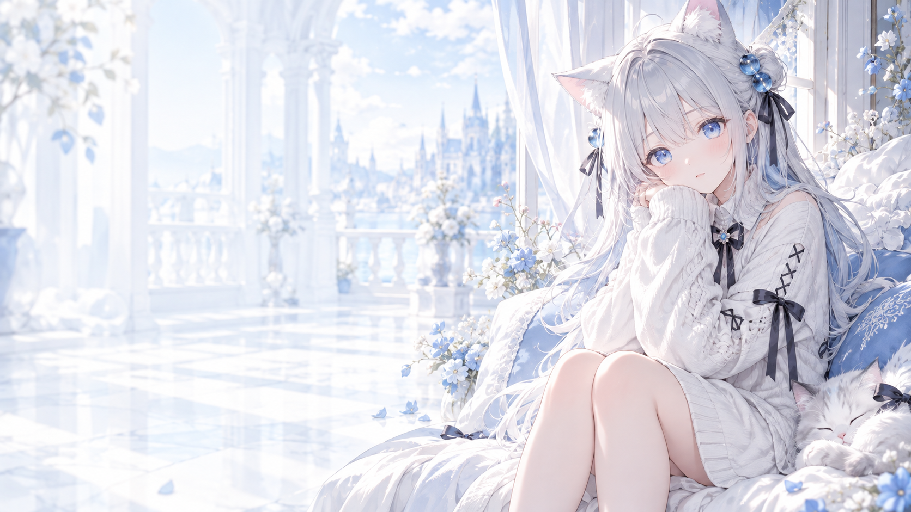
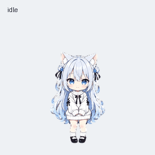

# 猫羽雫背景与动画宠物

猫羽雫主题背景，以及银蓝长发、蓝眼睛、猫耳的 Q 版动画宠物。

## 背景预览

- [下载背景 PNG](backgrounds/nekoha-background.png)：1672 × 941。
- 人物位于右侧，左侧保留较浅的背景，便于显示聊天内容。

## 宠物预览

- [下载宠物精灵图 PNG](pets/nekoha-pet-spritesheet.png)
- [查看静态宠物预览](previews/nekoha-pet-preview.png)
- [查看全部动画 GIF](previews/all-states.gif)
- [下载全部动画 MP4](previews/all-states.mp4)
- [查看待机、跳跃、落地衔接](previews/idle-jump-idle.gif)
- [查看十六个注视方向](previews/look-loop.gif)
- [查看动作联系表](previews/contact-sheet.png)
- [查看注视方向联系表](previews/look-directions.png)

## 使用

### Codex++ 背景

1. 下载 `backgrounds/nekoha-background.png`。
2. 打开 Codex++ 管理工具的“皮肤管理”，选择“从图片创建”。
3. 选择背景图片，将主题命名为“猫羽雫”，保存后应用。

此仓库提供背景素材，不修改应用安装文件，也不包含换肤软件。

### 动画宠物

`pets/nekoha-pet-spritesheet.png` 是透明背景的 v2 动画精灵图，不是普通头像：

- 图集尺寸：1536 × 2288。
- 网格：8 列、11 行；单格为 192 × 208。
- 前九行依次为待机、向右移动、向左移动、挥手、跳跃、失败、等待、工作、检查。
- 前九行的有效帧数依次为 6、8、8、4、5、8、6、6、6。
- 最后两行各 8 帧，共十六个顺时针注视方向。

请通过支持该格式的自定义宠物上传流程使用精灵图。GIF 和 MP4 仅用于预览，不能替代精灵图。

## 文件校验

`SHA256SUMS` 记录所有素材文件的 SHA-256，便于核对下载文件。

## 说明

本仓库为 AI 辅助制作的非官方角色主题素材，与 OpenAI、Codex++ 或角色原作者无隶属关系。角色相关权利归相应权利人；本仓库未附加再分发许可。
